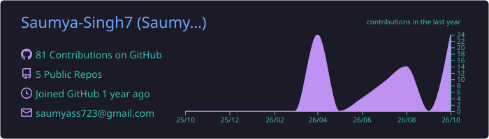

  

  

---

<h2 align="center"> About Me</h2>

I’m <strong>Saumya Singh</strong>, a Computer Science undergraduate at <strong>APJ Abdul Kalam Technical University</strong> with a strong foundation in software development and problem‑solving.  
Currently focusing on <strong>Data Structures & Algorithms</strong> and <strong>Full‑Stack Web Development</strong>, I enjoy building scalable, user‑centric applications using modern technologies like <strong>React, Tailwind CSS, Node.js, Express, and MongoDB</strong>.  
My goal is to grow into a <strong>Full‑Stack Developer</strong> capable of designing efficient systems and delivering impactful digital experiences.  
I’m passionate about continuous learning, clean code, and leveraging technology to solve real‑world challenges.

---

<h2 align="center"> Tech Stack</h2>

 

<h2 align="center"> 📊 GitHub Stats & Streak</h2>

  
  

  

---

<h2 align="center"> 🏆 GitHub Achievements</h2>

  

---

<h2 align="center">🚀 Featured Projects </h2>

<table>
<tr>
<td width="50%">

<h3> <a href="https://github.com/Saumya-Singh7/sms-detection">SMS Spam Detection System</a></h3>

<b>Tech:</b> Python, Machine Learning, NLP  

<ul>
<li> Developed a machine learning model to classify SMS messages as <b>Spam</b> or <b>Ham (Not Spam)</b></li>
<li> Performed text preprocessing including tokenization, stopword removal, and stemming</li>
<li> Converted text data into numerical features using <b>TF-IDF Vectorization</b></li>
<li> Implemented classification algorithms such as <b>Naive Bayes / Logistic Regression</b></li>
<li> Achieved high accuracy on test data with efficient model performance</li>
<li> Built a simple and user-friendly system for real-time message prediction</li>
</ul>

</td>

</tr>
</table>

<h2 align="center"> Connect With Me</h2>

  
  

  

  

---

<h2 align="center"> Quote</h2>

  <i><b>"Consistency and practice turns beginner into developer "</b></i>

